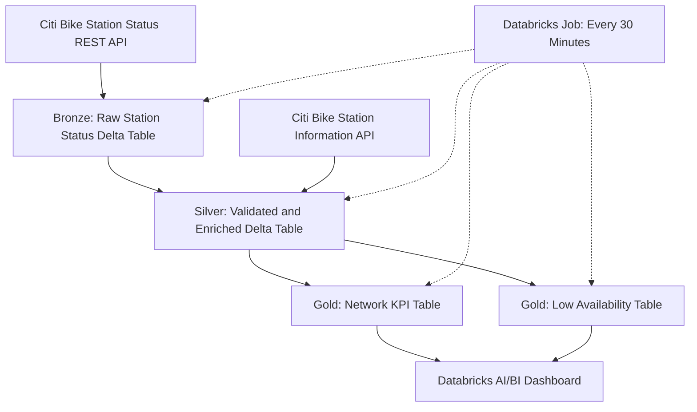

# Citi Bike Data Engineering Architecture

This project uses Databricks, PySpark, Delta Lake,
and a Bronze-Silver-Gold Medallion Architecture.

## Architecture Diagram

## Pipeline Features

- Bronze: REST API ingestion with snapshot IDs and timestamps
- Silver: Data cleaning, quality checks, station metadata enrichment, and incremental Delta MERGE
- Gold: Latest network KPIs and low-availability analytics
- Orchestration: Databricks Jobs every 30 minutes
- Monitoring: Freshness validation and failure notifications
- Visualization: Databricks AI/BI dashboard

