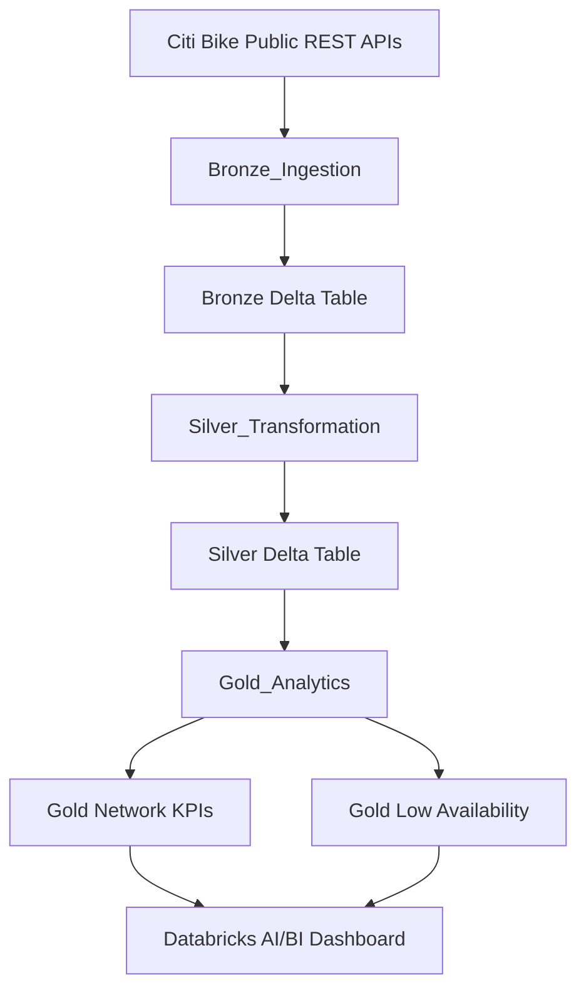

# Citi Bike Live Data Engineering — Pipeline Workflow

## 1. Overview

This document describes the automated data engineering workflow developed in Databricks for the Citi Bike Live Data Engineering Project.

The pipeline uses a Bronze–Silver–Gold Medallion Architecture to ingest live Citi Bike station data, transform and validate records, calculate operational KPIs, and refresh analytical tables.

**Databricks Job:** `CitiBike_Live_Data_Pipeline`

**Execution frequency:** Every 30 minutes

**Compute:** Databricks Serverless

**Data storage:** Delta Lake

**Orchestration:** Databricks Jobs

---

## 2. Pipeline Architecture



The pipeline executes three dependent notebook tasks.

| Order | Task | Notebook | Dependency |
|---|---|---|---|
| 1 | `Bronze_Ingestion` | `02_CitiBike_Bronze_Ingestion` | None |
| 2 | `Silver_Transformation` | `03_CitiBike_Silver_Transformation` | Bronze succeeded |
| 3 | `Gold_Analytics` | `04_CitiBike_Gold_Analytics` | Silver succeeded |

Each downstream task runs after its preceding task completes successfully.

---

## 3. Task 1 — Bronze Ingestion

### Purpose

Retrieve Citi Bike station availability data from the public GBFS Station Status API and preserve historical observations.

**API endpoint:**

`https://gbfs.citibikenyc.com/gbfs/en/station_status.json`

### Processing steps

1. Make an HTTP request to the Citi Bike API.
2. Check for HTTP errors.
3. Parse the JSON response.
4. Extract station status records.
5. Convert the station records into a PySpark DataFrame.
6. Generate a unique ingestion snapshot identifier.
7. Add an ingestion timestamp.
8. Append the records to the Bronze Delta table.

**Target table:**

`workspace.bronze.citibike_station_status`

### Output

A new batch of station observations identified by `snapshot_id`.

The ingestion timestamp identifies when the records entered the pipeline.

### Failure behavior

An API, JSON parsing, or Delta write error causes the Bronze task to fail.

Because Silver depends on Bronze succeeding, the downstream transformation is not launched when Bronze fails.

---

## 4. Task 2 — Silver Transformation

### Purpose

Transform raw Bronze data into validated and enriched station observations while preserving previously processed snapshots.

**Target table:**

`workspace.silver.citibike_station_enriched`

### Step A — Identify unprocessed snapshots

The notebook compares distinct snapshot identifiers in Bronze and Silver.

A Left Anti Join identifies Bronze snapshots that do not yet exist in Silver.

If no new snapshots are found, the notebook exits successfully using `NO_NEW_DATA`.

### Step B — Transform station status records

The transformation:

- Renames raw availability columns.
- Converts Unix station reporting times into timestamps.
- Converts rental and return flags to Boolean values.
- Preserves ingestion metadata.

### Step C — Validate incoming data

The notebook checks:

- Missing station identifiers
- Missing bike and dock availability values
- Negative availability counts
- Duplicate station identifiers within the same snapshot

Invalid records cause the validation stage to fail before the Delta MERGE.

### Step D — Enrich station metadata

The notebook retrieves station information from:

`https://gbfs.citibikenyc.com/gbfs/en/station_information.json`

Metadata includes station names, geographic coordinates, capacities, and station types.

The station status records are enriched using a Left Join on `station_id`.

### Step E — Calculate availability percentage

For stations with positive capacity:

\[
\text{Availability Percentage} =
\frac{\text{Available Bikes}}{\text{Station Capacity}}\times100
\]

Stations with zero or missing capacity receive a NULL availability percentage.

### Step F — Perform incremental Delta MERGE

The target/source matching condition is:

```sql
target.snapshot_id = source.snapshot_id
AND target.station_id = source.station_id
```

Only unmatched station observations are inserted.

Previously processed snapshots remain preserved.

### Step G — Verify Silver

After the MERGE, the notebook checks for duplicate `(snapshot_id, station_id)` combinations.

This verifies that the Silver table has not accumulated duplicate station observations.

---

## 5. Task 3 — Gold Analytics

### Purpose

Transform the latest validated Silver snapshot into business-ready analytical tables.

### Step A — Read the latest Silver snapshot

The notebook finds the maximum Silver `ingestion_timestamp` and filters records to that snapshot.

### Step B — Validate freshness

The notebook compares the latest ingestion timestamp with the current time.

**Freshness threshold:** 45 minutes.

The Gold task raises an error if:

- The latest ingestion timestamp is missing.
- Silver data is more than 45 minutes old.
- The timestamp is more than five minutes in the future.

This check runs during Gold execution, not continuously between runs.

### Step C — Calculate network KPIs

The notebook calculates:

- Total available bikes
- Total available e-bikes
- Total available docks
- Active renting stations
- Snapshot timestamp

**Target table:**

`workspace.gold.citibike_network_kpis`

The table is overwritten with the latest summary.

### Step D — Verify KPI data

The notebook verifies that the KPI table contains exactly one row.

An unexpected row count raises an error.

### Step E — Identify low-availability stations

Stations are selected using these conditions:

```sql
availability_percentage < 20
AND capacity > 0
AND is_renting = TRUE
```

**Target table:**

`workspace.gold.citibike_low_availability`

The table is overwritten with the latest qualifying stations.

### Step F — Verify low-availability data

The notebook checks that every saved record satisfies the low-availability business rules.

Invalid records cause the Gold task to fail.

---

## 6. Workflow Schedule

The Databricks Job runs every 30 minutes.

The approximate configured start times are:

- 26 minutes past the hour
- 56 minutes past the hour

These times represent the configured schedule; actual task execution may start later depending on platform scheduling and runtime conditions.

Each execution creates a new Bronze snapshot and attempts to process that snapshot through Silver and Gold.

### Execution sequence

```text
Scheduled trigger
      |
      v
Bronze_Ingestion
      |
      | Success
      v
Silver_Transformation
      |
      | Success
      v
Gold_Analytics
      |
      | Success
      v
Workflow completed
```

---

## 7. Dashboard Refresh

The Databricks AI/BI dashboard has a separate refresh schedule.

**Dashboard:** `Citi Bike | Live Operations Analytics`

**Refresh frequency:** Every 30 minutes.

**Configured refresh times:** Approximately 5 and 35 minutes past the hour.

The dashboard schedule is offset from the pipeline schedule to give Gold time to finish updating its analytical tables.

This provides a timing buffer, but it does not guarantee that every dashboard refresh occurs after the newest Gold update.

---

## 8. Job Monitoring and Notifications

### Run history

Databricks Job run history provides:

- Run start time
- Run duration
- Trigger type
- Task execution status
- Notebook execution output
- Error messages

### Failure notifications

Email notifications are configured for Job failures.

Successful runs do not need to generate notification emails.

### Data Quality Monitoring

Databricks Data Quality Monitoring is enabled for the Medallion schemas.

Freshness and completeness anomaly detection may require sufficient historical activity before its baseline is fully established.

Notebook-level data quality checks remain active independently of this monitoring system.

---

## 9. Troubleshooting Guide

| Problem | Possible cause | Recommended action |
|---|---|---|
| Bronze ingestion fails | API or network error | Inspect HTTP response and notebook logs |
| Silver exits with `NO_NEW_DATA` | No unprocessed snapshot IDs | Confirm Bronze created a new snapshot |
| `NameError` during manual execution | Required earlier cell was not executed | Run dependent cells in the correct order |
| Silver validation fails | Missing, negative, or duplicate records | Inspect validation counts before MERGE |
| Silver MERGE fails | Schema or source-data mismatch | Inspect source and target schemas |
| Gold freshness validation fails | Silver data is older than 45 minutes | Check Bronze and Silver task execution |
| Gold KPI verification fails | Unexpected row count | Inspect Gold calculation and overwrite operation |
| Dashboard displays old data | Dashboard queries have not refreshed | Check dashboard refresh schedule and Gold timestamps |
| Scheduled job fails | A task raised an exception | Open the failed task's notebook output |

---

## 10. Operational Limitations

The project demonstrates production-style data engineering patterns but has several limitations.

### API availability

The pipeline depends on external Citi Bike public endpoints. Temporary API failures may interrupt ingestion.

### Retry behavior

Retries were not enabled in the initial Job configuration. Transient failures may therefore require investigation or a future execution.

### Snapshot deduplication

Silver uses `(snapshot_id, station_id)` for incremental processing.

This prevents reinserting a previously processed snapshot, but a new Bronze run generates a new snapshot ID even if the API reports similar station values.

### Current metadata

Station information is fetched during Silver processing. Historical observations are enriched using the metadata available at processing time.

### Gold history

Current Gold tables represent the latest snapshot. Historical Bronze and Silver observations remain available for future trend analytics.

### Free Edition

Workspace resources and feature availability depend on Databricks Free Edition limits.

---

## 11. Future Improvements

Potential improvements include:

1. API retry logic with exponential backoff.
2. Structured pipeline logging and audit tables.
3. Automated unit and integration tests.
4. Explicit data contracts and schema-drift checks.
5. Historical hourly and daily Gold aggregations.
6. Deployment configuration and environment separation.
7. More advanced data quality alerting.
8. CI/CD integration with GitHub.

---

## 12. Related Documentation

- [Project README](../README.md)
- [Architecture Diagram](architecture.md)
- [Data Dictionary](data_dictionary.md)

---

**Project:** Citi Bike Live Data Engineering Pipeline

**Platform:** Databricks

**Architecture:** Bronze → Silver → Gold

**Technology stack:** Python, REST APIs, PySpark, Delta Lake, SQL, Databricks Jobs, Databricks AI/BI

*This is an independent educational portfolio project using public Citi Bike data.*
